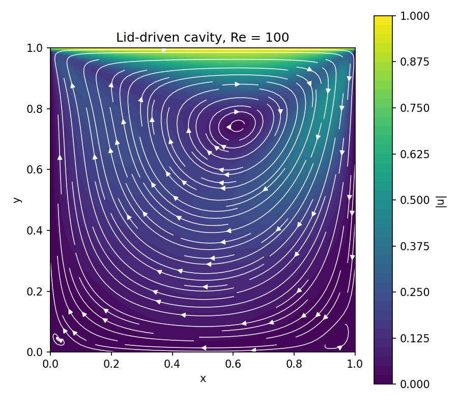
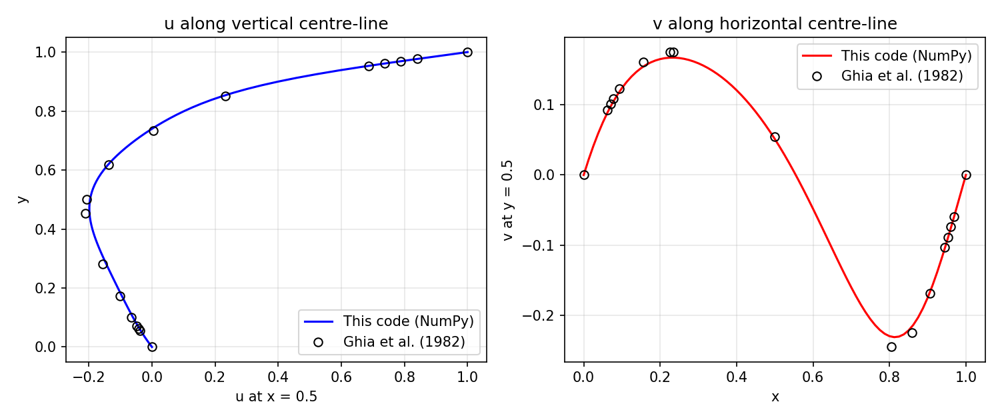
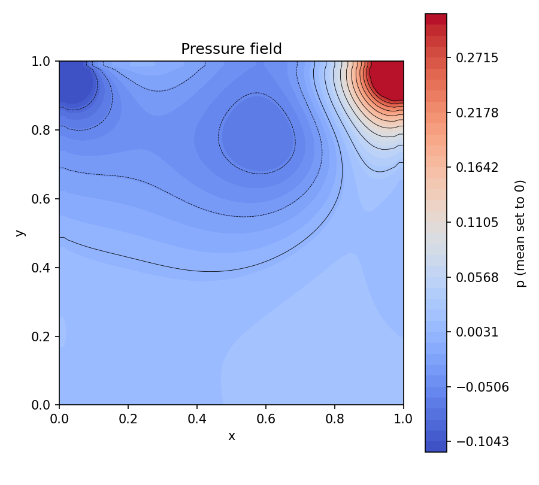
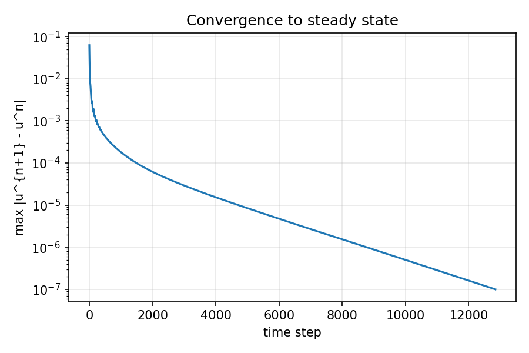

# Project 1 — Lid-Driven Cavity Flow with a Finite-Difference Navier–Stokes Solver

A from-scratch 2D incompressible Navier–Stokes solver written in **Python + NumPy**, applied to the classic lid-driven cavity at **Re = 100** and validated against the benchmark data of Ghia, Ghia & Shin (1982).



---

## 1. What is the problem?

A square box of side $L = 1$ is filled with fluid. The top wall (the "lid") slides to the right with constant speed $U = 1$, while the other three walls are fixed. The moving lid drags the fluid along, which sets up one large rotating vortex in the middle of the box plus small corner vortices at the bottom.

This test case is popular because the geometry is trivial (a square), the boundary conditions are simple, and yet the flow is fully two-dimensional and recirculating. It has therefore become one of the standard benchmarks for checking new incompressible flow solvers [1, 2].

The **Reynolds number** measures the ratio of inertial to viscous forces:

$$
Re = \frac{U L}{\nu}
$$

- $U$ — lid velocity (characteristic speed)
- $L$ — cavity size (characteristic length)
- $\nu$ — kinematic viscosity of the fluid

At $Re = 100$ the flow is laminar and reaches a steady state.

## 2. Governing equations

The flow obeys the incompressible Navier–Stokes equations [3]:

$$
\frac{\partial \mathbf{u}}{\partial t} + (\mathbf{u}\cdot\nabla)\mathbf{u} = -\frac{1}{\rho}\nabla p + \nu \nabla^2 \mathbf{u}
$$

$$
\nabla \cdot \mathbf{u} = 0
$$

Term by term:

| Term | Name | Meaning |
|---|---|---|
| $\partial \mathbf{u}/\partial t$ | unsteady term | how fast the velocity changes in time at a fixed point |
| $(\mathbf{u}\cdot\nabla)\mathbf{u}$ | convection | velocity is carried along by the flow itself (this is the non-linear term) |
| $-\frac{1}{\rho}\nabla p$ | pressure gradient | fluid is pushed from high to low pressure |
| $\nu\nabla^2\mathbf{u}$ | diffusion / viscosity | friction smooths out velocity differences |
| $\nabla\cdot\mathbf{u}=0$ | continuity | mass conservation: no fluid is created or destroyed, so the density stays constant |

Here $\mathbf{u} = (u, v)$ is the velocity, $p$ the pressure and $\rho$ the (constant) density.

**Boundary conditions:** $u = 1, v = 0$ on the lid; $u = v = 0$ (no-slip) on the other walls; $\partial p/\partial n = 0$ on all walls.

## 3. Numerical method: the projection (fractional-step) method

The difficulty in incompressible flow is that there is no separate equation for the pressure — the pressure simply takes whatever value is needed so that $\nabla\cdot\mathbf{u} = 0$. The projection method of Chorin [4] solves this by splitting each time step into three parts.

**Step 1 — Predictor.** Advance the velocity *ignoring* the pressure:

$$
\mathbf{u}^* = \mathbf{u}^n + \Delta t \left[ -(\mathbf{u}^n\cdot\nabla)\mathbf{u}^n + \nu\nabla^2\mathbf{u}^n \right]
$$

$\mathbf{u}^*$ is an intermediate velocity which, in general, is *not* divergence-free.

**Step 2 — Pressure Poisson equation.** Find the pressure that will remove the divergence:

$$
\nabla^2 p^{n+1} = \frac{\rho}{\Delta t}\,\nabla\cdot\mathbf{u}^*
$$

This follows from taking the divergence of Step 3 and requiring $\nabla\cdot\mathbf{u}^{n+1} = 0$.

**Step 3 — Corrector.** Subtract the pressure gradient:

$$
\mathbf{u}^{n+1} = \mathbf{u}^* - \frac{\Delta t}{\rho}\nabla p^{n+1}
$$

The new velocity is now (approximately) divergence-free. The steps are repeated until $\max|\mathbf{u}^{n+1} - \mathbf{u}^n| < 10^{-7}$, i.e. the flow is steady.

### Spatial discretisation

All derivatives are replaced by finite differences on a uniform $81 \times 81$ grid [3, 5]:

- **Diffusion** — second-order central differences, e.g. $\dfrac{\partial^2 u}{\partial x^2} \approx \dfrac{u_{i+1,j} - 2u_{i,j} + u_{i-1,j}}{\Delta x^2}$
- **Convection** — first-order **upwind** differences: the derivative is taken from the side the flow comes from. This is very stable and easy to understand, but it adds some numerical diffusion [3].
- **Pressure Poisson equation** — solved with Jacobi iteration: each point is repeatedly replaced by the average of its four neighbours minus the source term.

### Time step

An explicit scheme is only stable for small enough $\Delta t$. The code takes the smaller of the convective (CFL) limit $\Delta t \lesssim \Delta x / U$ and the diffusive limit $\Delta t \lesssim \Delta x^2/(4\nu)$, times a safety factor [3, 6].

## 4. Code structure

`cavity.py` is a single file (~200 lines) organised in five sections:

| Section | Function(s) | Purpose |
|---|---|---|
| 1 | — | parameters: grid size, Re, time step |
| 2 | `apply_velocity_bc`, `apply_pressure_bc` | boundary conditions |
| 2 | `predictor`, `poisson_rhs`, `solve_pressure`, `corrector` | the three projection steps |
| 3 | `run` | time loop until steady state |
| 4 | `GHIA_*` arrays | benchmark data from [1] |
| 5 | `plot_results` | figures and error numbers |

Everything is vectorised with NumPy array slicing (no Python loops over grid points), in the spirit of the "12 steps to Navier–Stokes" course [5].

## 5. How to run

```bash
pip install -r requirements.txt
python cavity.py
```

Runtime is about 30–60 s on a laptop. Figures are written to `results/`.

## 6. Results

### Validation against Ghia et al. (1982)

The horizontal velocity $u$ along the vertical centre-line and the vertical velocity $v$ along the horizontal centre-line are compared with the tabulated benchmark values of [1]:



The maximum deviation from the benchmark is about **0.013** for $u$ and **0.015** for $v$ (relative to $U = 1$). The small remaining difference, mostly at the velocity peaks, comes from the first-order upwind scheme and the moderate grid; it decreases with a finer grid or a higher-order convection scheme.

### Pressure field and convergence

| Pressure | Convergence |
|---|---|
|  |  |

The pressure is high in the top-right corner, where the lid pushes fluid into the wall, and low in the top-left corner, where fluid is pulled away. The residual decreases steadily, which shows that the solution reaches a true steady state.

## 7. Key take-aways (how to explain this project)

1. Incompressible flow needs a special trick for the pressure — the projection method turns the problem into "predict velocity → solve a Poisson equation → correct velocity".
2. Numerical choices matter: upwinding gives stability at the cost of some accuracy; the time step is limited by both convection and diffusion.
3. A CFD code is only trustworthy after **validation** against a reference — here the Ghia et al. benchmark [1].

## 8. Possible extensions

- Increase $Re$ to 400 or 1000 (finer grid needed) and compare with the other tables in [1].
- Replace upwinding with a second-order scheme (e.g. QUICK) [3].
- Use a staggered grid as in the MAC method [7], or a faster Poisson solver (multigrid / FFT).
- Port the solver to the GPU with CuPy by replacing `numpy` with `cupy`.

## References

1. U. Ghia, K. N. Ghia, C. T. Shin. High-Re solutions for incompressible flow using the Navier–Stokes equations and a multigrid method. *Journal of Computational Physics*, 48(3):387–411, 1982. doi:[10.1016/0021-9991(82)90058-4](https://doi.org/10.1016/0021-9991(82)90058-4)
2. O. Botella, R. Peyret. Benchmark spectral results on the lid-driven cavity flow. *Computers & Fluids*, 27(4):421–433, 1998. doi:[10.1016/S0045-7930(98)00002-4](https://doi.org/10.1016/S0045-7930(98)00002-4)
3. J. H. Ferziger, M. Perić, R. L. Street. *Computational Methods for Fluid Dynamics*, 4th ed. Springer, 2020. doi:[10.1007/978-3-319-99693-6](https://doi.org/10.1007/978-3-319-99693-6)
4. A. J. Chorin. Numerical solution of the Navier–Stokes equations. *Mathematics of Computation*, 22(104):745–762, 1968. doi:[10.1090/S0025-5718-1968-0242392-2](https://doi.org/10.1090/S0025-5718-1968-0242392-2)
5. L. A. Barba, G. F. Forsyth. CFD Python: the 12 steps to Navier–Stokes equations. *Journal of Open Source Education*, 1(9):21, 2018. doi:[10.21105/jose.00021](https://doi.org/10.21105/jose.00021)
6. R. Courant, K. Friedrichs, H. Lewy. Über die partiellen Differenzengleichungen der mathematischen Physik. *Mathematische Annalen*, 100:32–74, 1928. doi:[10.1007/BF01448839](https://doi.org/10.1007/BF01448839)
7. F. H. Harlow, J. E. Welch. Numerical calculation of time-dependent viscous incompressible flow of fluid with free surface. *Physics of Fluids*, 8(12):2182–2189, 1965. doi:[10.1063/1.1761178](https://doi.org/10.1063/1.1761178)
