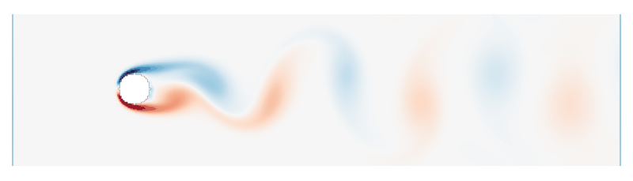
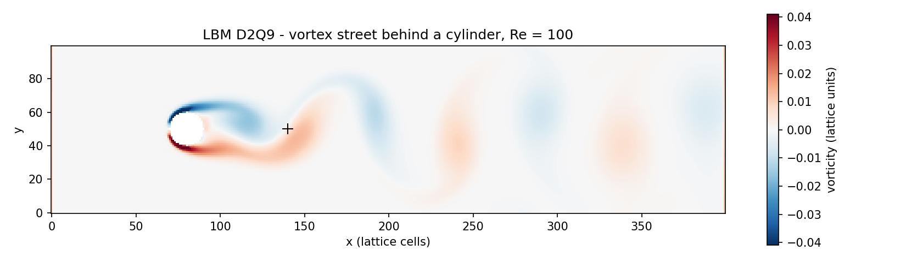
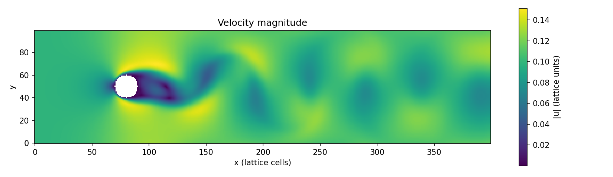
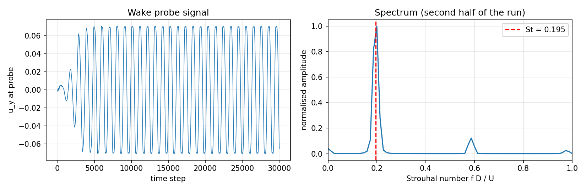

# Project 2 — Lattice-Boltzmann Simulation of Flow Past a Cylinder

A compact **lattice-Boltzmann method (LBM)** solver in pure **Python + NumPy** (D2Q9 lattice, BGK collision) that simulates the flow around a circular cylinder at **Re = 100** and reproduces the famous **von Kármán vortex street**. The shedding frequency is measured and expressed as a Strouhal number.



---

## 1. What is the problem?

When a fluid flows past a bluff body such as a cylinder, the flow separates on both sides. Above a Reynolds number of about 47 the wake becomes unstable and vortices are shed alternately from the top and the bottom of the cylinder. This periodic pattern is called the **von Kármán vortex street** [1]. It is responsible, for example, for the "singing" of power lines in the wind and for vibrations of chimneys and bridge cables.

Two dimensionless numbers describe the problem:

$$
Re = \frac{U D}{\nu}, \qquad St = \frac{f D}{U}
$$

- $U$ — inflow velocity, $D$ — cylinder diameter, $\nu$ — kinematic viscosity
- $f$ — vortex shedding frequency
- $St$ — **Strouhal number**, the dimensionless shedding frequency. For an unconfined cylinder at $Re = 100$, experiments give $St \approx 0.164$ [1].

## 2. Why lattice-Boltzmann?

Classical CFD (see Project 1) discretises the Navier–Stokes equations directly. The LBM takes a different route: it simulates a simplified *particle* picture of the fluid. Instead of the velocity $\mathbf{u}$ and pressure $p$, it tracks **distribution functions** $f_i(\mathbf{x}, t)$ — the amount of fluid at node $\mathbf{x}$ moving with a discrete velocity $\mathbf{c}_i$ [2, 3].

Advantages that make it attractive for students and for GPUs:

- the algorithm is only two simple steps, **collide** and **stream**;
- every step is local (a node only talks to its neighbours), so it parallelises perfectly;
- there is no pressure Poisson equation to solve;
- complex geometries are handled by simply marking nodes as "solid".

## 3. The D2Q9 lattice

"D2Q9" means **2** dimensions and **9** discrete velocities: one rest particle, four along the axes and four along the diagonals [4].

```
  6   2   5         c_0 = ( 0, 0)            weight w_0 = 4/9
    \ | /           c_1..c_4 = (±1,0),(0,±1) weight 1/9
  3 - 0 - 1         c_5..c_8 = (±1,±1)       weight 1/36
    / | \
  7   4   8
```

## 4. Governing equation: lattice-Boltzmann with BGK collision

$$
f_i(\mathbf{x} + \mathbf{c}_i \Delta t,\; t + \Delta t) = f_i(\mathbf{x}, t) - \frac{1}{\tau}\Big[f_i(\mathbf{x}, t) - f_i^{eq}(\mathbf{x}, t)\Big]
$$

Term by term:

| Term | Meaning |
|---|---|
| $f_i(\mathbf{x}, t)$ | fluid "population" at node $\mathbf{x}$ moving in direction $i$ |
| $f_i(\mathbf{x}+\mathbf{c}_i\Delta t, t+\Delta t)$ | **streaming**: after one time step the population has moved to the neighbouring node in direction $i$ |
| $-\frac{1}{\tau}[f_i - f_i^{eq}]$ | **collision** (BGK model [5]): particle collisions relax the distribution towards a local equilibrium |
| $\tau$ | relaxation time — how fast equilibrium is reached; it sets the viscosity |

### Equilibrium distribution

$$
f_i^{eq} = w_i\,\rho \left[ 1 + 3(\mathbf{c}_i\cdot\mathbf{u}) + \frac{9}{2}(\mathbf{c}_i\cdot\mathbf{u})^2 - \frac{3}{2}|\mathbf{u}|^2 \right]
$$

This is a second-order expansion of the Maxwell–Boltzmann distribution in the (small) velocity $\mathbf{u}$ [4]. The weights $w_i$ are those listed above.

### From particles back to fluid quantities

Density and velocity are simply sums (moments) over the populations:

$$
\rho = \sum_i f_i, \qquad \rho\,\mathbf{u} = \sum_i f_i\,\mathbf{c}_i, \qquad p = c_s^2\,\rho \;\text{ with }\; c_s^2 = \tfrac{1}{3}
$$

### Link to the Navier–Stokes equations

A multi-scale (Chapman–Enskog) expansion shows that, for small Mach numbers, this scheme reproduces the incompressible Navier–Stokes equations with viscosity [2, 3]

$$
\nu = c_s^2\left(\tau - \tfrac{1}{2}\right) = \frac{1}{3}\left(\tau - \tfrac{1}{2}\right)
$$

So the code chooses $\tau$ from the desired Reynolds number: $\nu = U D / Re$, then $\tau = 3\nu + 0.5$. All quantities are in lattice units ($\Delta x = \Delta t = 1$). The inflow speed $U = 0.1$ is kept well below the lattice speed of sound $c_s \approx 0.577$, so compressibility errors stay small [3].

## 5. Boundary conditions

| Boundary | Treatment |
|---|---|
| Cylinder surface | **bounce-back**: populations hitting a solid node are reversed, which gives a no-slip wall [3, 6] |
| Inlet (left) | populations set to the equilibrium with $\rho = 1$, $\mathbf{u} = (U, 0)$ |
| Outlet (right) | zero-gradient: populations copied from the neighbouring column |
| Top / bottom | periodic (comes automatically from `np.roll`) |

A small one-signed transverse velocity "kick" is added just behind the cylinder at $t = 0$ to break the perfect up/down symmetry, so that vortex shedding starts quickly.

## 6. Simulation parameters

| Parameter | Value |
|---|---|
| Lattice | $400 \times 100$ nodes |
| Cylinder diameter $D$ | 20 nodes, centred at $x = 80$ |
| Inflow velocity $U$ | 0.1 (lattice units) |
| Reynolds number | 100 |
| Relaxation time $\tau$ | 0.56 |
| Time steps | 30 000 |

## 7. Code structure

`lbm_cylinder.py` (~230 lines):

| Function | Purpose |
|---|---|
| `equilibrium` | computes $f_i^{eq}(\rho, \mathbf{u})$ for the whole grid at once |
| `macroscopic` | computes $\rho$ and $\mathbf{u}$ from $f_i$ |
| `run` | time loop: macroscopic → collide → bounce-back → stream → inlet/outlet |
| `strouhal` | FFT of a velocity probe signal in the wake → $St$ |
| `plot_results` | vorticity, velocity, spectrum and GIF animation |

The populations are stored as one NumPy array of shape `(9, NY, NX)`; streaming is one `np.roll` per direction. This vectorised style is close to the well-known compact LBM examples in [7].

## 8. How to run

```bash
pip install -r requirements.txt
python lbm_cylinder.py           # full run, a few minutes
python lbm_cylinder.py --quick   # 6000 steps, for testing
```

## 9. Results

### Vortex street



Red and blue are vortices rotating in opposite directions, shed alternately from the top and bottom of the cylinder. The black cross marks the probe used for the frequency measurement.



### Shedding frequency



The transverse velocity behind the cylinder grows from the initial kick and settles into a clean periodic oscillation after about 5000 steps. The shedding period, measured from the zero crossings of the signal over the second half of the run, gives **St ≈ 0.195** (the FFT on the right shows the same peak, plus a weak third harmonic).

This is higher than the value of about 0.164 measured for an isolated cylinder [1]. The difference is expected: because the top and bottom boundaries are periodic, the simulation actually represents a row of cylinders spaced only $5D$ apart, so the flow is strongly confined. Confinement speeds up the flow past the cylinder and raises the shedding frequency, the same trend that is well documented for cylinders between walls [8]. A taller domain (e.g. `NY = 300`, larger runtime) moves the result towards the isolated-cylinder value.

## 10. Key take-aways (how to explain this project)

1. LBM simulates fluid as particle distributions on a lattice; the algorithm is just **collide + stream**.
2. The relaxation time $\tau$ controls the viscosity through $\nu = (\tau - 1/2)/3$.
3. Walls are handled by bounce-back — no body-fitted mesh needed.
4. The method captures unsteady physics (vortex shedding) and can be validated with a dimensionless number, the Strouhal number.

## 11. Possible extensions

- Use the Zou–He velocity/pressure boundary conditions [9] for a more accurate inlet and outlet.
- Compute drag and lift coefficients and compare with the Schäfer–Turek benchmark [10].
- Replace BGK by an MRT collision operator for better stability at higher Re [3].
- Run on a GPU by replacing `numpy` with `cupy`, or rewrite the update in PyTorch / JAX.

## References

1. C. H. K. Williamson. Vortex dynamics in the cylinder wake. *Annual Review of Fluid Mechanics*, 28:477–539, 1996. doi:[10.1146/annurev.fl.28.010196.002401](https://doi.org/10.1146/annurev.fl.28.010196.002401)
2. S. Chen, G. D. Doolen. Lattice Boltzmann method for fluid flows. *Annual Review of Fluid Mechanics*, 30:329–364, 1998. doi:[10.1146/annurev.fluid.30.1.329](https://doi.org/10.1146/annurev.fluid.30.1.329)
3. T. Krüger, H. Kusumaatmaja, A. Kuzmin, O. Shardt, G. Silva, E. M. Viggen. *The Lattice Boltzmann Method: Principles and Practice*. Springer, 2017. doi:[10.1007/978-3-319-44649-3](https://doi.org/10.1007/978-3-319-44649-3)
4. Y. H. Qian, D. d'Humières, P. Lallemand. Lattice BGK models for Navier–Stokes equation. *Europhysics Letters*, 17(6):479–484, 1992. doi:[10.1209/0295-5075/17/6/001](https://doi.org/10.1209/0295-5075/17/6/001)
5. P. L. Bhatnagar, E. P. Gross, M. Krook. A model for collision processes in gases. *Physical Review*, 94(3):511–525, 1954. doi:[10.1103/PhysRev.94.511](https://doi.org/10.1103/PhysRev.94.511)
6. S. Succi. *The Lattice Boltzmann Equation for Fluid Dynamics and Beyond*. Oxford University Press, 2001.
7. P. Mocz. Create your own lattice Boltzmann simulation (with Python). 2020. [github.com/pmocz/latticeboltzmann-python](https://github.com/pmocz/latticeboltzmann-python)
8. M. Sahin, R. G. Owens. A numerical investigation of wall effects up to high blockage ratios on two-dimensional flow past a confined circular cylinder. *Physics of Fluids*, 16(5):1305–1320, 2004. doi:[10.1063/1.1668285](https://doi.org/10.1063/1.1668285)
9. Q. Zou, X. He. On pressure and velocity boundary conditions for the lattice Boltzmann BGK model. *Physics of Fluids*, 9(6):1591–1598, 1997. doi:[10.1063/1.869307](https://doi.org/10.1063/1.869307)
10. M. Schäfer, S. Turek. Benchmark computations of laminar flow around a cylinder. In *Flow Simulation with High-Performance Computers II*, Notes on Numerical Fluid Mechanics 52, pp. 547–566. Vieweg, 1996. doi:[10.1007/978-3-322-89849-4_39](https://doi.org/10.1007/978-3-322-89849-4_39)
