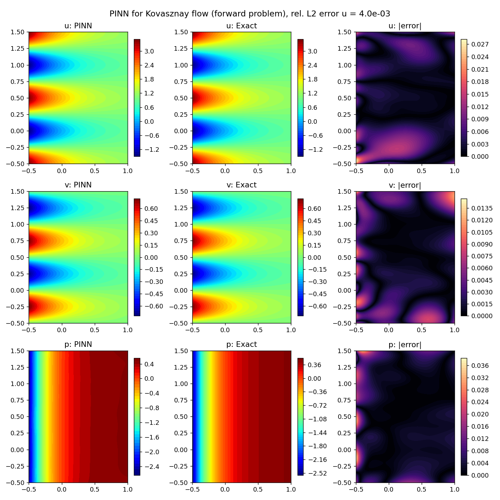
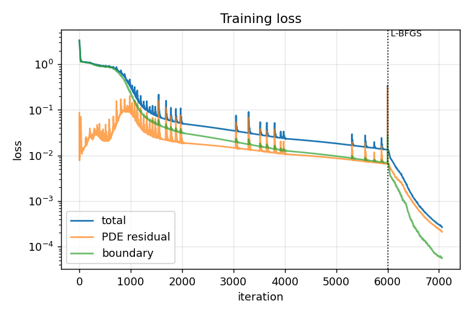

# Project 3 — Physics-Informed Neural Network for Kovasznay Flow (PyTorch)

A small **physics-informed neural network (PINN)** in **PyTorch** [11] that solves the steady 2D incompressible Navier–Stokes equations for **Kovasznay flow**. Because this flow has an exact analytical solution, the accuracy of the network can be measured precisely. The project covers two cases:

- **Forward problem** — the Reynolds number is known; the network learns the velocity and pressure fields using only the equations and the boundary values (no interior data).
- **Inverse problem** — the Reynolds number is *unknown*; from 100 scattered velocity measurements the network recovers the full flow field **and** the Reynolds number.



---

## 1. What is a PINN?

A normal neural network learns from data only. A PINN additionally knows the physics: the governing PDE is built into the loss function [1, 2]. The network takes the coordinates $(x, y)$ as input and outputs the flow variables $(u, v, p)$. Because a neural network is a smooth function, all derivatives such as $\partial u/\partial x$ or $\partial^2 u/\partial y^2$ can be computed exactly with **automatic differentiation** [3], without any mesh.

Training then searches for network weights that make

1. the PDE residuals vanish at many random points inside the domain,
2. the boundary conditions hold on the boundary,
3. (inverse case) the network agree with the measured data.

Compared with Projects 1 and 2 there is no grid and no time stepping — the PDE is solved by optimisation.

## 2. Kovasznay flow

Kovasznay [4] found an exact solution of the steady Navier–Stokes equations that describes the laminar flow behind a two-dimensional grid of cylinders:

$$
u(x,y) = 1 - e^{\lambda x}\cos(2\pi y)
$$

$$
v(x,y) = \frac{\lambda}{2\pi}\, e^{\lambda x}\sin(2\pi y)
$$

$$
p(x,y) = \frac{1}{2}\left(1 - e^{2\lambda x}\right)
$$

$$
\lambda = \frac{Re}{2} - \sqrt{\frac{Re^2}{4} + 4\pi^2}
$$

- $u, v$ — velocity components in $x$ and $y$; $p$ — pressure (density $\rho = 1$)
- $\lambda$ — a negative constant fixed by the Reynolds number, so the disturbance $e^{\lambda x}$ decays downstream
- far downstream ($x \to \infty$) the flow becomes uniform: $u \to 1$, $v \to 0$

We use $Re = 20$ on the domain $x \in [-0.5, 1]$, $y \in [-0.5, 1.5]$, the same set-up as the NSFnets study [5].

## 3. Governing equations (what the PINN must satisfy)

Steady, incompressible, non-dimensional Navier–Stokes equations [6]:

$$
u\frac{\partial u}{\partial x} + v\frac{\partial u}{\partial y} + \frac{\partial p}{\partial x} - \frac{1}{Re}\left(\frac{\partial^2 u}{\partial x^2} + \frac{\partial^2 u}{\partial y^2}\right) = 0
$$

$$
u\frac{\partial v}{\partial x} + v\frac{\partial v}{\partial y} + \frac{\partial p}{\partial y} - \frac{1}{Re}\left(\frac{\partial^2 v}{\partial x^2} + \frac{\partial^2 v}{\partial y^2}\right) = 0
$$

$$
\frac{\partial u}{\partial x} + \frac{\partial v}{\partial y} = 0
$$

Term by term:

| Term | Meaning |
|---|---|
| $u\,\partial u/\partial x + v\,\partial u/\partial y$ | convection — momentum carried by the flow (non-linear) |
| $\partial p/\partial x$ | pressure force |
| $\frac{1}{Re}\nabla^2 u$ | viscous diffusion; small $1/Re$ = less viscous |
| $\partial u/\partial x + \partial v/\partial y = 0$ | mass conservation for an incompressible fluid |

The left-hand sides evaluated with the network outputs are called the **residuals** $r_x, r_y, r_c$. For the exact solution they are zero.

## 4. Loss function

$$
\mathcal{L} = \underbrace{\frac{1}{N_r}\sum_{k=1}^{N_r}\left(r_x^2 + r_y^2 + r_c^2\right)}_{\text{physics}}
+ \underbrace{\frac{1}{N_b}\sum_{k=1}^{N_b}\left[(u - u_b)^2 + (v - v_b)^2\right]}_{\text{boundary}}
+ \underbrace{\frac{1}{N_d}\sum_{k=1}^{N_d}\left[(u - u_d)^2 + (v - v_d)^2\right]}_{\text{data (inverse only)}}
$$

- $N_r = 2000$ random collocation points inside the domain, where the residuals are evaluated
- $N_b = 400$ points on the boundary with known velocities $u_b, v_b$ (from the exact solution)
- $N_d = 100$ interior velocity "measurements" $u_d, v_d$ — used only in the inverse problem

The pressure needs no boundary condition; it is determined up to a constant by the equations, so pressure errors are measured after removing the mean.

## 5. Network and training

| Item | Choice |
|---|---|
| Architecture | fully connected, 2 inputs → 4 hidden layers × 50 neurons → 3 outputs ($u, v, p$) |
| Activation | $\tanh$ (smooth, so second derivatives exist) [1] |
| Initialisation | Xavier/Glorot normal [7] |
| Input scaling | $x, y$ mapped to $[-1, 1]$ |
| Optimiser | Adam [8] (6000 iterations, learning rate $10^{-3}$ halved every 2000) followed by L-BFGS [9] (up to 1000 iterations) |
| Inverse parameter | $\log(1/Re)$ is a trainable `nn.Parameter`; initial guess $Re = 5$ |

Adam is robust in the early, noisy phase of training; L-BFGS uses curvature information and quickly polishes the solution at the end. This two-stage strategy is common practice for PINNs [1, 5]. Learning $\log(1/Re)$ instead of $Re$ keeps the viscosity positive.

## 6. Code structure

`pinn_kovasznay.py` (~280 lines):

| Part | Purpose |
|---|---|
| `exact` | analytical Kovasznay solution |
| training points | collocation, boundary and data points |
| `PINN` class | the network and the (possibly trainable) $1/Re$ |
| `grad`, `pde_residual` | derivatives with `torch.autograd.grad` and the Navier–Stokes residuals |
| `loss_fn` | physics + boundary + data loss |
| `train` | Adam then L-BFGS |
| `evaluate` | errors on a $151 \times 201$ grid and figures |

The code runs on a GPU automatically if PyTorch finds CUDA; otherwise on the CPU.

## 7. How to run

```bash
pip install -r requirements.txt
python pinn_kovasznay.py                  # forward problem
python pinn_kovasznay.py --mode inverse   # inverse problem: identify Re
python pinn_kovasznay.py --quick          # short test run
```

Each full run takes about 4–5 minutes on a laptop CPU (2 cores).

## 8. Results

### Forward problem

Relative $L_2$ errors on a fine test grid:

| $u$ | $v$ | $p$ |
|---|---|---|
| 0.38 % | 1.2 % | 0.70 % |

The figure at the top of this page shows PINN prediction, exact solution and absolute error for $u$, $v$ and $p$. The network reproduces the flow without seeing a single interior data point — only the physics and the boundary values.



Adam brings the loss down by about two orders of magnitude (the occasional spikes are typical of Adam on PINN losses); after the switch to L-BFGS (dotted line) the loss drops by almost two more orders of magnitude.

### Inverse problem

From 100 random velocity measurements (black dots) the PINN reconstructs the full $u, v, p$ fields — including the pressure, which was never measured — and identifies the Reynolds number:

**Identified Re = 19.84** (true value 20, error 0.8 %). Relative $L_2$ errors: $u$ = 0.24 %, $v$ = 1.1 %, $p$ = 0.70 %.


Starting from the wrong guess $Re = 5$, the estimate first overshoots, settles near 18.6 during the Adam phase, and is then pulled to 19.84 by L-BFGS once the PDE residual becomes small. The physics term is what makes this possible: the velocity data alone contain no information about the viscosity.

## 9. Key take-aways (how to explain this project)

1. A PINN represents the solution by a neural network and enforces the PDE through the loss, using automatic differentiation for the derivatives.
2. The same code solves both forward and inverse problems; in the inverse case unknown physical parameters simply become extra trainable variables.
3. An analytical solution makes it possible to verify the method quantitatively — a crucial step before applying PINNs to real data.
4. Limitations: training is slower than a classical solver for forward problems, and PINNs can struggle at high Reynolds numbers or for sharp gradients [2, 10]. Their main strength is combining sparse data with physics.

## 10. Possible extensions

- Add noise to the measurements and study robustness of the identified $Re$.
- Try adaptive loss weights or residual-based adaptive sampling [10].
- Solve an unsteady problem, e.g. the cylinder wake from Project 2, as in [1].
- Re-implement the same model in TensorFlow (`tf.GradientTape`) or JAX for comparison.

## References

1. M. Raissi, P. Perdikaris, G. E. Karniadakis. Physics-informed neural networks: A deep learning framework for solving forward and inverse problems involving nonlinear partial differential equations. *Journal of Computational Physics*, 378:686–707, 2019. doi:[10.1016/j.jcp.2018.10.045](https://doi.org/10.1016/j.jcp.2018.10.045)
2. G. E. Karniadakis, I. G. Kevrekidis, L. Lu, P. Perdikaris, S. Wang, L. Yang. Physics-informed machine learning. *Nature Reviews Physics*, 3:422–440, 2021. doi:[10.1038/s42254-021-00314-5](https://doi.org/10.1038/s42254-021-00314-5)
3. A. G. Baydin, B. A. Pearlmutter, A. A. Radul, J. M. Siskind. Automatic differentiation in machine learning: a survey. *Journal of Machine Learning Research*, 18(153):1–43, 2018.
4. L. I. G. Kovasznay. Laminar flow behind a two-dimensional grid. *Mathematical Proceedings of the Cambridge Philosophical Society*, 44(1):58–62, 1948. doi:[10.1017/S0305004100023999](https://doi.org/10.1017/S0305004100023999)
5. X. Jin, S. Cai, H. Li, G. E. Karniadakis. NSFnets (Navier–Stokes flow nets): Physics-informed neural networks for the incompressible Navier–Stokes equations. *Journal of Computational Physics*, 426:109951, 2021. doi:[10.1016/j.jcp.2020.109951](https://doi.org/10.1016/j.jcp.2020.109951)
6. F. M. White. *Viscous Fluid Flow*, 3rd ed. McGraw-Hill, 2006.
7. X. Glorot, Y. Bengio. Understanding the difficulty of training deep feedforward neural networks. In *Proceedings of AISTATS*, PMLR 9:249–256, 2010.
8. D. P. Kingma, J. Ba. Adam: A method for stochastic optimization. *ICLR*, 2015. [arXiv:1412.6980](https://arxiv.org/abs/1412.6980)
9. D. C. Liu, J. Nocedal. On the limited memory BFGS method for large scale optimization. *Mathematical Programming*, 45:503–528, 1989. doi:[10.1007/BF01589116](https://doi.org/10.1007/BF01589116)
10. S. Wang, Y. Teng, P. Perdikaris. Understanding and mitigating gradient flow pathologies in physics-informed neural networks. *SIAM Journal on Scientific Computing*, 43(5):A3055–A3081, 2021. doi:[10.1137/20M1318043](https://doi.org/10.1137/20M1318043)
11. A. Paszke et al. PyTorch: An imperative style, high-performance deep learning library. In *Advances in Neural Information Processing Systems 32 (NeurIPS)*, 2019.
